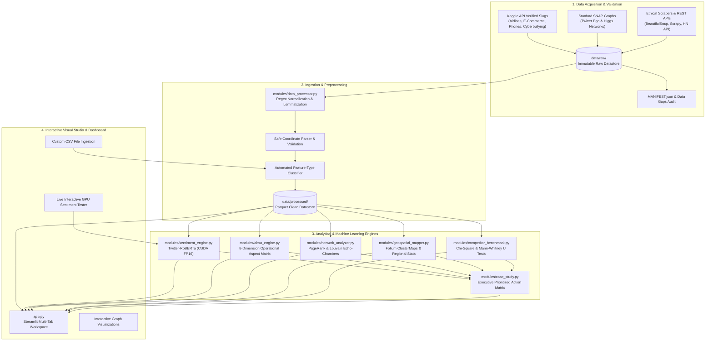

# BrandPulse AI: Pipeline Architecture & Data Flow Specification

This document details the architectural layout, pipeline processing flow, persistent datastores, and analytical modules powering **BrandPulse AI**.

---

## 1. High-Level System Architecture

---

## 2. Datastore Structure & Persistence Layers

| Directory / File | Type | Persistence Role |
| :--- | :--- | :--- |
| `data/raw/` | Filesystem | Immutable source repository storing Kaggle CSVs, Stanford SNAP edgelists, and raw web crawls. |
| `data/raw/MANIFEST.json` | JSON | Cryptographic MD5 checksums, row counts, column schemas, and verified license tracking. |
| `data/processed/` | Parquet | Cleaned, normalized, and coordinate-validated analytical datasets ready for production querying. |
| `cache/` | Parquet / Pickle | In-memory and disk serialized model predictions, sentiment matrices, and sub-graphs for instantaneous dashboard reload. |
| `reports/tables/` | CSV | Exported analytical tables (correlations, Pareto distributions, ABSA matrices, network centrality leaderboards). |
| `reports/figures/` | PNG / HTML | Statistical figures (confusion matrices, ROC curves, Pareto charts) and interactive HTML maps/graphs. |
| `reports/data_gaps.md` | Markdown | Audit trail tracking real data availability versus gaps per enterprise audit standards. |

---

## 3. Pipeline Execution Stages

### Phase 1: Ingestion, Schema Profiling & Statistical Diagnostics
- **Module**: `modules/data_processor.py`
- **Functions**: `load_airline_sentiment()`, `classify_feature_types()`, `compute_sentiment_trends()`, `compute_correlations_and_associations()`, `compute_pareto_complaints()`, `detect_outliers_comprehensive()`
- **Outputs**:
  - `data/processed/airline_sentiment_cleaned.parquet`
  - `reports/tables/feature_types.csv`
  - `reports/tables/correlation_matrix.csv`
  - `reports/tables/pareto_complaint_drivers.csv`
  - `reports/tables/outliers_iqr_zscore.csv`
  - `reports/figures/seaborn_correlation_heatmap.png`
  - `reports/figures/pareto_complaints.png`

### Phase 2: Deep Transformer Sentiment Modeling
- **Module**: `modules/sentiment_engine.py`
- **Model**: `cardiffnlp/twitter-roberta-base-sentiment-latest`
- **Acceleration**: NVIDIA CUDA GPU FP16 with dynamic batch fallback (32 -> 16 -> 8 -> 4 -> 1)
- **Outputs**:
  - `cache/airline_predictions.parquet`
  - `reports/tables/sentiment_classification_report.csv`
  - `reports/tables/model_summary_metrics.csv`
  - `reports/figures/confusion_matrix.png`
  - `reports/figures/roc_curves.png`
  - `reports/figures/precision_recall_curves.png`

### Phase 3: Aspect-Based Sentiment Analysis (ABSA)
- **Module**: `modules/absa_engine.py`
- **Dimensions**: Logistics/Delivery, Customer Support, Product Quality, Price/Value, Flight Delays, Baggage, Booking/Cancellations, Cabin Experience.
- **Outputs**:
  - `cache/aspect_brand_matrix.parquet`
  - `reports/tables/absa_matrix.csv`
  - `reports/tables/absa_summary_metrics.csv`

### Phase 4: Social Graph Dynamics & Echo-Chamber Analysis
- **Module**: `modules/network_analyzer.py`
- **Algorithms**: NetworkX PageRank ($\alpha=0.85$), Betweenness Centrality, Louvain Community Detection, Homophily Index, Sentiment Assortativity.
- **Outputs**:
  - `reports/tables/influencer_centrality_leaderboard.csv`
  - `reports/tables/community_echo_metrics.csv`
  - `reports/figures/pyvis_echo_chamber_network.html`
  - `reports/figures/pyvis_snap_network.html`

### Phase 5: Geospatial Intelligence & Interactive Cartography
- **Module**: `modules/geospatial_mapper.py`
- **Cartography**: Folium OpenStreetMap MarkerClusters, complaint density HeatMaps, Plotly Mapbox scatter.
- **Outputs**:
  - `reports/tables/regional_sentiment_stats.csv`
  - `reports/figures/folium_sentiment_map.html`
  - `reports/figures/folium_sentiment_map_approx.html`

### Phase 6: Competitor Benchmarking & Hypothesis Testing
- **Module**: `modules/competitor_benchmark.py`
- **Statistical Tests**: Chi-Square Test of Independence (Cramér's V effect size), Mann-Whitney U Test (rank-biserial effect size).
- **Outputs**:
  - `reports/tables/competitor_significance_tests.csv`

### Phase 7: Web Scraping & REST API Ingestion Pipelines
- **Module**: `modules/scrapers_demo.py` & `scrapy_project/`
- **Mechanics**: Robots.txt verification, politeness throttling, Scrapy asynchronous crawler, Hacker News and Wikimedia REST APIs.

### Phase 8: Strategic Decision Support & Executive Action Plan
- **Module**: `modules/case_study.py`
- **Outputs**:
  - `reports/case_study_executive_report.md`
  - `reports/tables/recommendation_decision_matrix.csv`

---

## 4. Interactive Dashboard Studio (`app.py`)

The Streamlit web application organizes these capabilities into 7 interactive views with granular user controls:
1. **Executive Overview & Benchmarks**: Real-time KPI summary, competitor differential cards, statistical significance tests.
2. **Feature Intelligence & Visual Studio**: Custom CSV dataset uploader, automated column schema classification, interactive Plotly visualization studio.
3. **Aspect Sentiment & Deep ML Models**: Aspect $\times$ Brand polarity heatmap, RoBERTa evaluation curves, and live text interactive scoring.
4. **Geospatial Sentiment & Regional Maps**: Folium interactive maps with exact GPS toggle, regional vulnerability tables.
5. **Social Network Dynamics & Echo-Chambers**: Node count slider, interactive PyVis graph topology, Louvain modularity and homophily metrics.
6. **Web Scraping & REST APIs**: Live sandbox scraper execution, Scrapy subprocess runner, and REST API live feeds.
7. **Strategic Case Study & Action Plan**: Prioritized Impact vs Effort matrix, executive mitigation blueprint.
